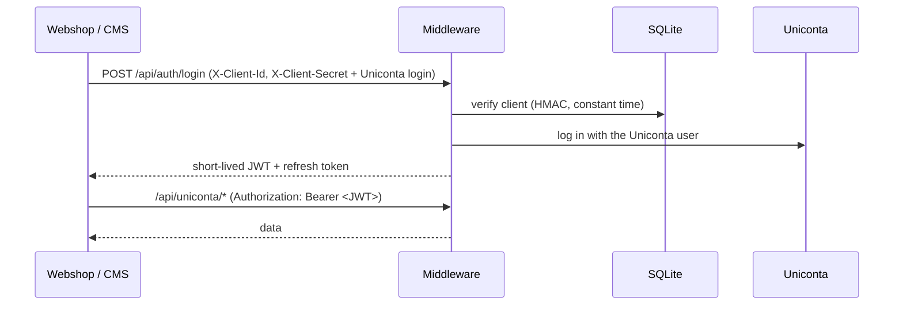
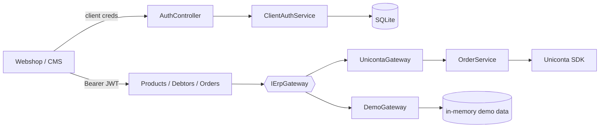

# SoftCode Uniconta Middleware

[](https://github.com/DritonCa/SoftcodeUnicontaMiddlewarepublic/actions/workflows/ci.yml)
[](LICENSE)

A small **ASP.NET Core (.NET 8)** web API between your **webshop or CMS** and **Uniconta ERP**.
It turns Uniconta's SDK into a clean, secured REST API: orders become sales orders with the
right debtor, invoices are posted when the webshop says so, and the invoice PDF comes back
from Uniconta itself.

Works with Magento, WooCommerce, Shopify apps, Umbraco or anything that can send an HTTP
request.

**Try it:** a public demo with fictional data runs at **https://demo.softcode.dk/swagger** –
create a demo account at [softcode.dk/uniconta](https://softcode.dk/uniconta).

---

## Features

- **Orders → sales orders.** The debtor is matched on EAN, CVR, e-mail and address
  (case- and spacing-insensitive, best match on ties) and created when none matches.
- **Private, company (CVR) and public-sector (EAN) customers**, incl. GLN and electronic
  (OIOUBL) invoicing for EAN.
- **Text lines** under a product (e.g. "Participant: Jane Doe"), parcel-shop delivery,
  shipping as an amount line.
- **Invoicing on demand** – the webshop posts the invoice when the payment is captured and
  gets Uniconta's invoice number back. Invoiced sales orders leave the open-orders list.
- **Invoice PDFs** by invoice number or by webshop order number.
- **Products and debtors** as stable, flat DTOs (no raw SDK object graphs).
- **Multi-tenant** – each customer has its own client credentials and logs in with its own
  Uniconta user; an admin UI shows companies, clients and the order log.
- **Secure by default** – two-step auth (client credentials → short-lived JWT), HMAC-hashed
  client secrets, encrypted credential cache, rate-limited login, refuses to start with
  placeholder secrets.
- **Demo mode** – the same API on fictional data, with self-service demo accounts and Swagger.

## How authentication works



The Uniconta password is used once at login and cached **encrypted** server-side with a TTL;
it never travels inside the token. See [SECURITY.md](SECURITY.md).

## API

| Method | Route | Purpose |
| --- | --- | --- |
| `POST` | `/api/auth/login` | Client credentials (headers) + Uniconta user → JWT + refresh token |
| `POST` | `/api/auth/refresh` | Rotate the tokens |
| `GET` | `/api/uniconta/products` | Products, paged (`offset`, `limit`, `includeDynamic`) |
| `GET` | `/api/uniconta/products/{sku}` | One product |
| `GET` | `/api/uniconta/debtors` | Debtors, paged |
| `GET` | `/api/uniconta/debtors/{account}` | One debtor |
| `POST` | `/api/uniconta/orders` | Create a sales order from a webshop order |
| `GET` | `/api/uniconta/orders/{orderNumber}` | Does the sales order exist? |
| `DELETE` | `/api/uniconta/orders/{orderNumber}` | Delete it (e.g. cancelled in the webshop); 404 = nothing to delete |
| `POST` | `/api/uniconta/orders/{orderNumber}/invoice` | Post the invoice, returns `invoiceNumber` |
| `GET` | `/api/uniconta/orders/invoice/{invoiceNumber}/pdf` | Invoice PDF by invoice number |
| `GET` | `/api/uniconta/orders/{orderNumber}/invoice/pdf` | Latest invoice PDF for an order (number in `X-Uniconta-Invoice-Number`) |
| `POST` | `/api/demo/signup` | Demo mode only: create a demo account |

Errors: `400` invalid input · `401` missing/invalid credentials or token · `404` not found ·
`422` Uniconta rejected the operation · `429` rate limited. Internal details are logged, never
returned.

### Example order

```json
{
  "orderId": 1001,
  "customerType": "ean",
  "email": "invoices@municipality.example",
  "ean": "5790000000001",
  "contactName": "John Smith",
  "paymentCode": "NK30",
  "deliveryName": "John Smith",
  "deliveryAddress": "Rådhuspladsen 99",
  "deliveryPostcode": "2000",
  "deliveryCity": "Frederiksberg",
  "shippingAmount": 49,
  "shippingProductSku": "SHIP-1",
  "items": [
    { "sku": "DW-1001", "name": "Coffee mug", "price": 39.96, "qty": 10 },
    { "sku": "DW-9001", "name": "Online course", "price": 1196, "qty": 1,
      "isNonShippable": true, "textLines": ["Participant: Jane Doe"] }
  ]
}
```

Prices are **excluding VAT** (Uniconta adds VAT from the item setup). Send
`"pricesIncludeTax": true` if your shop sends prices including 25 % VAT.

## Getting started

**Prerequisites:** .NET 8 SDK and a Uniconta user with API access (or demo mode).

```bash
git clone https://github.com/DritonCa/SoftcodeUnicontaMiddlewarepublic.git
cd SoftcodeUnicontaMiddlewarepublic
dotnet user-secrets set "Jwt:Key" "$(openssl rand -hex 32)"
dotnet user-secrets set "Auth:SecretPepper" "$(openssl rand -hex 16)"
dotnet run
```

On first run the app creates a SQLite database and an API client with a random secret,
printed once to the console. Swagger is at `/swagger` in development.

To try it without Uniconta, set `Erp:DataSource` to `Demo`.

### Docker

```bash
docker build -t softcode-uniconta-middleware .
docker run -p 8080:8080 \
  -e Jwt__Key=<64 hex chars> -e Auth__SecretPepper=<32 hex chars> \
  -v uniconta-data:/data -v uniconta-keys:/app/dataprotection-keys -v uniconta-logs:/app/logs \
  softcode-uniconta-middleware
```

`deploy/compose.demo.yaml` runs the public demo (fictional data, Swagger on, hardened container).

## Configuration

Use environment variables (`Section__Key`), user-secrets or a git-ignored
`appsettings.Production.json` for real values.

| Key | Default | Meaning |
| --- | --- | --- |
| `Jwt:Key` | – (required) | JWT signing key, ≥ 32 chars |
| `Auth:SecretPepper` | – (required) | Server-side key for hashing client secrets, ≥ 16 chars |
| `Jwt:Issuer` / `Jwt:Audience` | `Softcode.*` | JWT validation values |
| `ConnectionStrings:AppDb` | local SQLite file | Database for clients and admin users |
| `Erp:DataSource` | `Uniconta` | `Uniconta` or `Demo` (fictional data) |
| `Orders:Country` | `Denmark` | Uniconta country for new debtors and deliveries |
| `Orders:DebtorVatCode` | `U25` | VAT code on new debtors |
| `Orders:DebtorGroups:{privat,cvr,ean}` | `PRIV`, `CVR`, `EAN` | Debtor group per customer type (must exist in Uniconta) |
| `Orders:RequisitionFormat` | `Web order {0}` | Requisition on the sales order |
| `Orders:DeleteOrderWhenInvoiced` | `true` | Remove the sales order from open orders once invoiced |
| `Swagger:Enabled` | `false` | Swagger outside development (the demo turns it on) |
| `Demo:AccountLifetimeDays` | `14` | How long a demo account works |
| `Demo:TurnstileSecret` | – | Cloudflare Turnstile secret; when set, sign-up requires a token |
| `Demo:AllowedOrigins` | – | Browser origins allowed to call the sign-up endpoint |
| `Demo:SignupsPerHour` | `3` | Sign-ups per IP per hour |
| `Network:TrustCloudflareHeader` | `false` | Use `CF-Connecting-IP` for rate limiting; only when the origin accepts Cloudflare only |

The app **refuses to start** if `Jwt:Key` or `Auth:SecretPepper` is missing, a placeholder or
too short.

## Demo mode

With `Erp:DataSource=Demo` every endpoint works on a fictional company (products, debtors,
orders, invoices and PDFs) and nothing reaches Uniconta. Each demo account gets its own
company, reset after 24 hours, so testers never see each other's data. `POST /api/demo/signup`
issues client credentials that expire after `Demo:AccountLifetimeDays`; it is rate limited,
has a honeypot field and supports Cloudflare Turnstile.

## Architecture



Controllers are thin; everything they need from the ERP goes through `IErpGateway`, so the
real and demo data sources share the same validation, status codes and Swagger contract.

**Tech:** .NET 8 · ASP.NET Core · Uniconta .NET SDK · EF Core (SQLite) · Data Protection ·
JWT + refresh tokens · built-in rate limiter · Swashbuckle.

## Testing

```bash
dotnet test
```

The xUnit suite covers secret hashing, client authentication (incl. expired demo clients),
JWTs and refresh tokens, the credential store, debtor matching, order header/line/text-line
mapping, the configurable order options and the demo data store. CI runs build + tests on
every push.

## Need help?

Setup, adaptation to your Uniconta company or webshop integration:
[SoftCode](https://softcode.dk) – Magento and Uniconta integration in Copenhagen.

## License

MIT — see [LICENSE](LICENSE).
